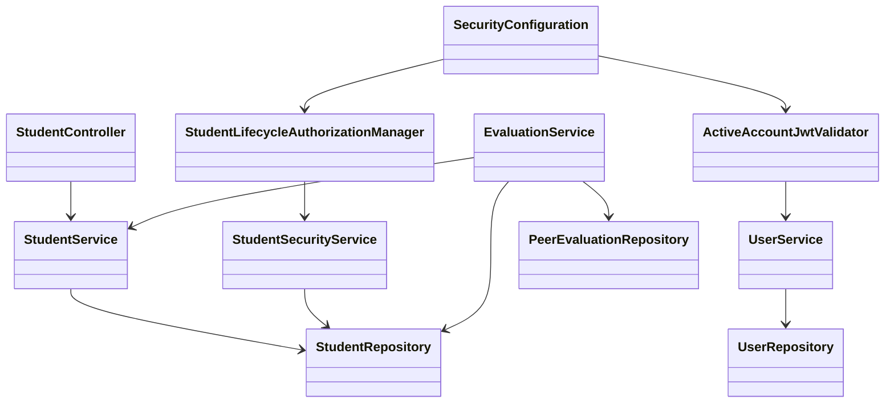
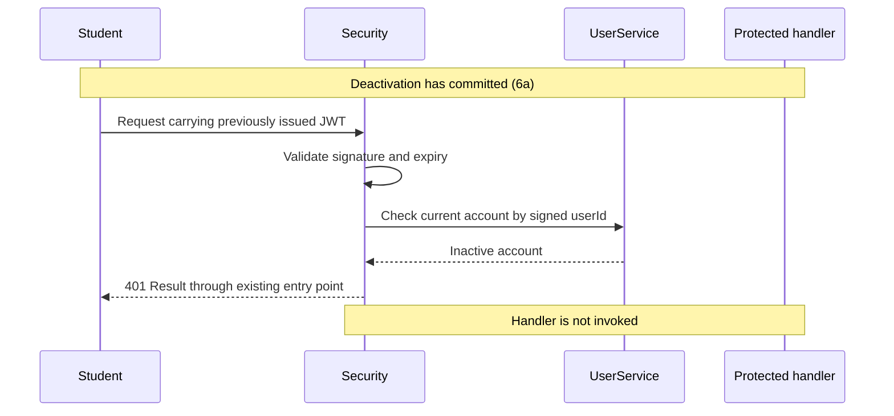

# Student Design

> Realizes: [UC-STU-deactivate-student](../requirements/use-cases.md#uc-stu-deactivate-student-the-course-admininstructor-deactivates-a-student).
> Depends on FRs: [FR-SEC-active-account, FR-SEC-authorization, FR-SEC-deny-unauthorized](../requirements/software-requirements-specification.md#security-and-authorization-requirements).
> See: [Container Diagram](architectural-design.md#containers), [architectural conventions](architectural-design.md#architectural-conventions), and the SRS [Business Domain Model](../requirements/software-requirements-specification.md#business-domain-model).

## Overview

Extend the existing student vertical slice rather than introducing another account model. The existing `Student` inherits `enabled` from `PeerEvaluationUser`; its optional team and required course section remain the ownership links. Student lookup, DTO conversion, profile editing, and the management dialog already exist. Before this design is implemented, profile editing toggles `enabled`, there is no dedicated deactivation endpoint, and JWT authentication does not consult current account status. This document designs the remaining work; it does not claim those changes are built.

Policy is owned by BR-student-lifecycle, BR-section-scoped-access, BR-student-inactive-team-membership, BR-submission-owed, BR-evaluation-active-evaluatee, and BR-evaluation-inactive-history in [business-rules.md](../requirements/business-rules.md). Reactivation implementation is outside this change.

## Components & classes



| Component | Reuse or change |
|---|---|
| [StudentController](../../backend/src/main/java/team/projectpulse/student/StudentController.java), [StudentService](../../backend/src/main/java/team/projectpulse/student/StudentService.java), [StudentRepository](../../backend/src/main/java/team/projectpulse/student/StudentRepository.java), [StudentSpecs](../../backend/src/main/java/team/projectpulse/student/StudentSpecs.java), [StudentSecurityService](../../backend/src/main/java/team/projectpulse/student/StudentSecurityService.java) | Reused; add the action, scoped lookup, and lifecycle permission check. |
| [Student](../../backend/src/main/java/team/projectpulse/student/Student.java), [PeerEvaluationUser](../../backend/src/main/java/team/projectpulse/user/PeerEvaluationUser.java), [StudentDto](../../backend/src/main/java/team/projectpulse/student/dto/StudentDto.java), [DTO converters](../../backend/src/main/java/team/projectpulse/student/converter) | Reused; no persistence-model change. Add a deactivation response DTO containing the converted student and outcome. |
| `security/authorizationmanagers/StudentLifecycleAuthorizationManager.java` | New; thin wrapper over the student permission service, with fail-closed path-variable parsing. |
| `security/ActiveAccountJwtValidator.java` | New; additional JWT validation using a current-account lookup by the signed `userId` claim. |
| [SecurityConfiguration](../../backend/src/main/java/team/projectpulse/security/SecurityConfiguration.java), [UserService](../../backend/src/main/java/team/projectpulse/user/UserService.java), [UserRepository](../../backend/src/main/java/team/projectpulse/user/UserRepository.java) | Reused; wire the validator and route rule; add the account-status service method. |
| [EvaluationService](../../backend/src/main/java/team/projectpulse/evaluation/EvaluationService.java), [PeerEvaluationRepository](../../backend/src/main/java/team/projectpulse/evaluation/PeerEvaluationRepository.java), [PeerEvaluationAverage](../../backend/src/main/java/team/projectpulse/evaluation/PeerEvaluationAverage.java) | Reused; enforce evaluatee eligibility, select historical report rows, and expose `enabled` in summaries. |
| [Students.vue](../../frontend/src/pages/students/Students.vue), [EditStudentForm.vue](../../frontend/src/pages/students/EditStudentForm.vue), [student API](../../frontend/src/apis/student/index.ts), [student types](../../frontend/src/apis/student/types.ts) | Reused; dedicated action in the existing details/edit dialog, confirmation, response handling, and parent-table refresh. |
| [SubmitTeamsEvaluations.vue](../../frontend/src/pages/evaluations/SubmitTeamsEvaluations.vue), [SectionsEvaluations.vue](../../frontend/src/pages/evaluations/admin/SectionsEvaluations.vue), [evaluation types](../../frontend/src/apis/evaluation/types.ts) | Reused; eligible new entries, stale-form recovery, and an inactive label. |

## Sequence

### Deactivate a student

```mermaid
sequenceDiagram
    actor Instructor
    participant UI as Student details
    participant Security
    participant Controller as StudentController
    participant Service as StudentService
    participant DB as StudentRepository
    Instructor->>UI: View student details (steps 1-2)
    Instructor->>UI: Choose Deactivate (step 3)
    UI-->>Instructor: Consequences and confirmation (step 4)
    Instructor->>UI: Confirm (step 5)
    UI->>Security: POST /students/{studentId}/deactivate
    Security->>Security: Validate current caller and lifecycle permission
    alt Caller cannot manage the selected student (2a)
        Security-->>UI: 403 Result; no mutation
    else Caller is permitted
        Security->>Controller: Authorized request
        Controller->>Service: Deactivate selected student
        Service->>DB: Load within caller's permitted scope
        alt Already inactive (3a)
            Service-->>Controller: Student, already-inactive outcome
        else Active
            Service->>DB: Set enabled=false; transaction commits
            Service-->>Controller: Student, deactivated outcome
        end
        Controller-->>UI: 200 Result (step 6)
        UI-->>Instructor: Outcome and refreshed student status
    end
```

The service transaction must finish before the response claims success. The scoped student lookup acquires a pessimistic write lock and refreshes the managed student under that lock before checking `enabled`. It changes only `enabled`. Repeated authorized requests return the same inactive state without repeating side effects. A student on no team uses the same action. Cancellation at step 4 closes the warning without invoking the API (4a).

### Existing login after deactivation



Keep default JWT signature/time validation and compose the account check with it. Parse `userId` defensively; absent, malformed, nonpositive, out-of-range, deleted, or inactive identities fail authentication. Read through `UserService`, not a feature repository or a cached `enabled` claim. The check applies to student and instructor accounts because FR-SEC-active-account covers both; password authentication continues to use `MyUserPrincipal.isEnabled()`.

The shared Axios `401` handler already clears token/user state and redirects to login. An idle browser receives no push logout; its next protected request is refused. The requirement does not cancel requests authenticated before deactivation commits. A token can be accepted again after reactivation if it is otherwise valid; permanent token revocation is outside this design.

## API contract

Paths are relative to `/api/v1`; use the existing `Result` envelope and central error handling. The request body cannot supply caller scope.

| Endpoint | Caller | Request | Success | Errors / extensions |
|---|---|---|---|---|
| **New** `POST /students/{studentId}/deactivate` | Owning course admin or instructor assigned to the selected student's course section | Path ID; no body | `200`; data contains `student` (existing StudentDto) and `outcome` (`deactivated` or `already-inactive`) | `401` unauthenticated/inactive caller; `403` unauthorized (2a), missing/malformed target or unavailable scope; authorized inactive target returns `200` (3a); cancellation sends no request (4a). |
| Existing `GET /students/{studentId}` | Existing callers plus the owning course admin even when not assigned to the course section | Path ID | Existing student-details response | Preserve existing authentication failures and fail-closed scope denial. |
| Existing `PUT /students/{studentId}` | Existing profile-edit callers | Existing profile DTO | Existing profile response | Reject an attempted active-to-inactive transition with `400` before mutating profile fields; message directs caller to the dedicated action. Keep existing reactivation behavior. |
| Existing `POST /evaluations` | Existing authorized evaluator | Existing evaluation DTO | Existing evaluation response | `400` if the new evaluation names an inactive evaluatee, including a stale form and an earlier evaluated week; no new row is saved (UC-EVA-submit-evaluation 9a). Existing validation and authorization still apply. |
| Existing `GET /evaluations/sections/{sectionId}/week/{week}` | Existing authorized instructor/admin | Course section and week | Existing report; summaries additionally expose current `enabled` status | Preserve existing errors; report inclusion follows BR-evaluation-inactive-history. |

### Permission and persistence scope

Register the POST explicitly before the API deny-all rule in `SecurityConfiguration`; use the new lifecycle manager, not the existing self-or-instructor manager. Permit an admin who owns the selected student's course, or an instructor assigned to that student's course section. A role alone, the instructor's default course section, and team instructor assignment are insufficient.

Build one reusable student scope specification/query from the caller ID and roles obtained through `UserUtils`. Use it in both `StudentSecurityService` and the service's student lookup; bind target ID and permitted scope in the persistence query. Check permission before reporting an inactive state. Unresolvable targets fail closed with `403`, matching the existing authorization convention rather than revealing existence through `404` or `500`.

For GET student details, combine the existing rule with lifecycle permission so an owning course admin unassigned to the course section can reach the action. Do not grant students lifecycle permission. The generic PUT guard applies only to deactivation; building or redesigning reactivation is excluded.

### Frontend behavior

In the existing details/edit dialog, show Deactivate for an active student; replace its editable status switch with displayed status. For an inactive student, retain existing reactivation behavior. Do not save unsaved profile edits as part of deactivation. On success use the returned outcome, update the displayed student, and refresh the parent list. Block duplicate confirmation while pending. A failure shows no success message and does not optimistically change account status; an uncertain network result is resolved by reloading details before another attempt.

Use an Element Plus confirmation warning naming the student and covering the consequences cited by the use case: existing-login access, submissions/reminders, new evaluations, retained membership/work, and historical reporting. Cancel, Escape, and close all follow 4a.

### Evaluation eligibility and historical reports

In `EvaluationService.addPeerEvaluation`, obtain the evaluatee through a new `StudentService` locking lookup participating in the evaluation transaction. Acquire the same pessimistic write lock on the student row used by deactivation, refresh the managed entity under that lock (the DTO converter may already have loaded it), and validate current account status before saving. Keep the lock until the evaluation transaction commits, preserving existing team and submission-window checks. This orders the two operations: evaluation first means its save commits before deactivation; deactivation first means the evaluation sees inactive and is rejected. Do not rely on an earlier read or an ordinary JPA query returning a previously managed entity. Deactivation itself performs no evaluation rewrite or deletion. Existing evaluation edits continue through the current update path and its window checks.

In the evaluation form, merge stored evaluations with the current roster: retain existing entries (including those of now-inactive evaluatees), and create unsaved entries only for active teammates. Choose POST versus PUT per entry according to whether it is stored. After an inactive-evaluatee rejection, reload roster and stored evaluations, remove ineligible unsaved entries, and retain eligible unsaved input. Do not automatically retry saved entries or claim a batch was saved when some requests failed.

For the section report, retain the existing selection of active students on teams. Add inactive students who have received at least one evaluation for the selected week, including those on no team. Obtain received-evaluatee IDs through the evaluation repository scoped by the evaluatee's course section and requested week, then select rows from that course section's roster. Do not filter stored scores or comments by evaluator activity. Reuse `getPeerEvaluationAverage` (already null-safe for team name), populate `enabled`, and render an Inactive label beside the student's name. Leave visibility restrictions intact.

## Key decisions

| Choice | Rejected alternative and reason |
|---|---|
| Dedicated action; generic profile PUT cannot deactivate | A status toggle permits the consequential operation without the dedicated warning flow. |
| Current account lookup on every JWT request | Waiting for expiry or trusting a token's old status leaves FR-SEC-active-account unmet; a blocklist adds persistence/lifecycle machinery this requirement does not need. |
| Route permission plus scoped service query | A role-only route crosses course-section boundaries; an unrestricted primary-key lookup leaves scope outside the persistence boundary. |
| Authorized repeat returns success and already-inactive outcome | An error makes retries/concurrent requests harder to handle despite the desired state already holding. |
| Reuse membership and stored records | Removing membership or rewriting history conflicts with the cited lifecycle policies and complicates reactivation. |
| Frontend eligibility plus server validation | The roster display alone cannot enforce policy against direct requests or a stale form. |
| Shared student-row lock and refreshed account state through commit | An unlocked check-then-save permits an evaluation to persist after deactivation despite BR-evaluation-active-evaluatee; a schema-level lifecycle redesign is unnecessary. |
| Historical inclusion based on received evaluations | Filtering out all inactive accounts hides records; keeping all inactive roster rows creates empty rows suggesting missing work. |

## Data model

No new tables, columns, account states, or Flyway migration. Reuse the SRS [Business Domain Model](../requirements/software-requirements-specification.md#business-domain-model). The deactivation response and summary `enabled` field are API projections, not persisted additions. No deactivation timestamp is needed: historical inclusion uses stored evaluations, not inferred withdrawal dates.

## Reuse & cross-cutting

Reuse JWT, `AuthorizationManager`, `UserUtils`, `Result`, DTO converters, exception handling, shared Axios, and Element Plus. `SubmissionStatusService` remains the single implementation of BR-submission-owed; verify its behavior after deactivation rather than adding another eligibility definition. The student foundation does not call evaluation or notification services. No new job, email, token store, or notification mechanism is introduced.

The approved Level-1 delta is limited to account-status validation in the authentication runtime view and Security & Compliance section. Those sections explicitly distinguish the design target from today's implementation. General refresh/revocation remains TD-jwt-revocation.

## Tests

Rows are named so the implementation PR can map every row to concrete tests. Expected values come from the cited requirement, not production helpers. Integration tests assert HTTP status, Result envelope, and persisted effects; frontend tests with stubbed APIs prove UI behavior only. Use real signed tokens for authentication tests. Commit deactivation between HTTP requests in those tests, outside the base test's rollback transaction, and restore fixtures explicitly so the test exercises the specified commit boundary.

| Row | Oracle / flow | Level | Asserts |
|---|---|---|---|
| `deactivate-main` | UC-STU-deactivate-student steps 1-6 | Integration + Cypress | Details identify the student; consequences precede the request; confirm sets inactive and refreshes status. |
| `deactivate-permitted-callers` | BR-student-lifecycle; BR-section-scoped-access | Integration | Assigned instructor and owning admin succeed; owner succeeds even unassigned to the course section; exercise an admin role without relying on a literal instructor role. |
| `deactivate-membership` | BR-student-inactive-team-membership | Integration | Team ID remains unchanged; unassigned student remains unassigned. |
| `deactivate-preserves-work` | BR-student-lifecycle; BR-evaluation-active-evaluatee | Integration | Activity reports and evaluations authored/received retain IDs, contents, ratings, and comments after deactivation. |
| `deactivate-unauthorized` | Extension 2a | Integration | Student (including self), unassigned instructor, and unrelated admin get 403; no account, membership, or work changes. |
| `deactivate-authorization-order` | Extension 2a; associated authorization information | Integration | Unauthorized inactive target receives the same denial without an already-inactive outcome. |
| `deactivate-invalid-target` | FR-SEC-deny-unauthorized; fail-closed contract | Integration | Missing/malformed target IDs return 403 Result, never 500 or target details. |
| `deactivate-repeat` | Extension 3a | Integration | Repeat and target deactivated after form load yield already-inactive; no extra effects; works with no active students remaining. |
| `deactivate-cancel` | Extension 4a | Cypress | Cancel, Escape, and close send no deactivation request and preserve displayed status. |
| `deactivate-confirmation-state` | Steps 5-6 | Cypress | Double click sends one request; 4xx/5xx or network failure shows no success; reloading resolves an uncertain outcome. |
| `deactivate-existing-token` | Extension 6a; FR-SEC-active-account | Integration | A real JWT succeeds before committed deactivation and receives 401 on protected read/write requests afterward; write has no effect. |
| `deactivate-authentication-regression` | FR-SEC-active-account; existing JWT contract | Unit + integration | Inactive password login fails; active users succeed; disabled instructor's token fails; expired/invalid tokens remain rejected; missing/malformed userId or deleted identity fails closed. |
| `deactivate-profile-bypass` | Dedicated action; step 4 | Integration | Active-to-inactive PUT receives 400 with no profile mutation; ordinary profile edits still work; no new reactivation behavior. |
| `deactivate-submission-status` | BR-submission-owed | Integration | Inactive student owes no WAR/evaluation, receives no reminder, and is not a required evaluatee; existing active teammates' obligations remain correct. |
| `deactivate-new-evaluation` | BR-evaluation-active-evaluatee; UC-EVA-submit-evaluation 9a | Integration | Active evaluator's new evaluation of an inactive teammate is rejected without saving, including an earlier week and a form opened before deactivation; active evaluatee still succeeds. |
| `deactivate-evaluation-ordering` | BR-evaluation-active-evaluatee | Integration | Use independent MySQL transactions and synchronization barriers to exercise both lock orders: evaluation commits before deactivation, or waits for deactivation and is rejected. An evaluation that checked active cannot save after a completed deactivation; do not substitute sequential requests or sleep-based timing for the interleaving. |
| `deactivate-evaluation-form` | UC-EVA-submit-evaluation 9a | Cypress | New entries exclude inactive students; rejection refreshes eligibility; existing saved entries remain; partial success is not retried as new submissions. |
| `deactivate-report-inclusion` | BR-evaluation-inactive-history | Integration | Inactive student with received evaluations is present for that week, including without a team; absent for weeks with no received evaluations; authored-only evaluation does not qualify her row. |
| `deactivate-report-calculation` | BR-evaluation-inactive-history; report algorithm | Integration | Scores and comments include inactive evaluators; independent fixture totals 58 and 50 yield 54 before/after deactivation; private comments retain existing access restrictions. |
| `deactivate-report-label` | BR-evaluation-inactive-history | Cypress | Report displays Inactive from enabled=false and does not mark active rows inactive. |
| `deactivate-existing-evaluation-edit` | BR-evaluation-editable-until-close; BR-evaluation-submission-window | Integration | Active evaluator may edit an existing evaluation of an inactive teammate within the window; closed-window edits still fail; new evaluation remains disallowed. |

### Implementation commits

1. **Trunk:** shared current-account lookup, student locking/refresh service operation, and JWT validation with their tests. Stop for the developer to inspect this commit before the dependent work.
2. **Security rule:** lifecycle manager and scoped permission/query support, explicit deactivation rule and student-details read access, with authorization tests.
3. **Student leaf:** endpoint/service result, repeat behavior, and generic profile guard with persistence tests.
4. **Evaluation leaf:** eligibility, historical report projection, and integration tests.
5. **Frontend leaves:** details action, confirmation, evaluation form, report label, and Cypress coverage.

## Open questions / risks

- The design gate remains the developer's merge of the design PR; conversation approval authorizes writing this document, not implementing it.
- Per-request account reads add database work. There is no stale-status cache; performance should be measured if this becomes material.
- A request authenticated before deactivation commits may finish afterward; cancelling in-flight operations is outside FR-SEC-active-account's stated boundary.
- Reactivation remains on the legacy profile path. Existing stale profile updates may affect that path; this change neither redesigns reactivation nor claims old tokens are permanently revoked.
- Concurrent duplicate deactivations are harmless state assignments. New evaluation saves and deactivation are ordered by the shared student-row lock above. This design does not claim serializable ordering against concurrent legacy reactivation or team transfers.
- Cypress stubs cannot prove database preservation, server authorization, or token rejection. Those require the listed integration tests and Docker/MySQL; no runtime tests have been run at design time.
